# Intelligence-in-a-box (Hand Cranked Token Generator)
A hand-cranked token generator. Built for the coming apocalypse.

No WIFI or charging is needed (as long as you scavenge some reciept paper).
Please come see me in the apocalypse for any queries.

Operated by writing a question on a card then turning the crank a bunch.
A language model the box reads the handwriting and prints the answer.

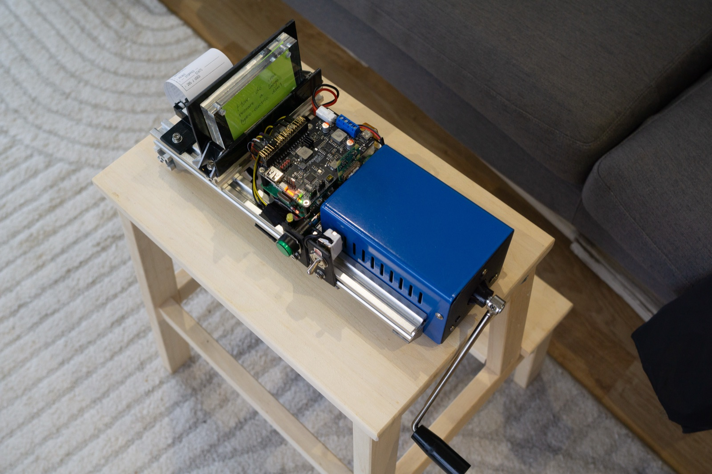

It only thinks while you turn the crank - and I made it self-aware of this fact.

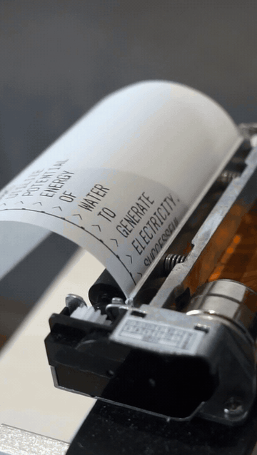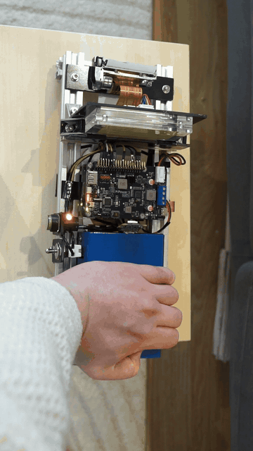

## How it works

<table align="center">
  <tr>
    <td align="center">
      <strong>1. Write your question</strong> 
      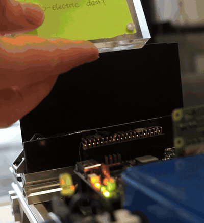
    </td>
    <td align="center">
      <strong>2. Press button</strong> 
      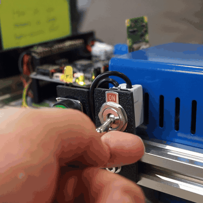
    </td>
  </tr>
  <tr>
    <td align="center">
      <strong>3. Crank</strong> 
      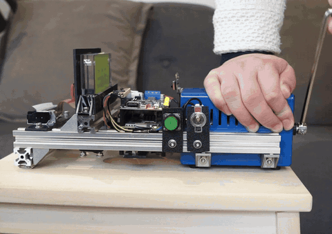
    </td>
    <td align="center">
      <strong>4. Receive wisdom</strong> 
      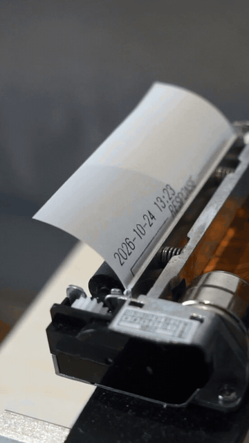
    </td>
  </tr>
</table>

- **Reading:** the Pi camera photographs the card and a small OCR pipeline (RapidOCR, PP-OCRv5 mobile) reads the handwriting in about 2 seconds. I tried a vision LLM first; it was just as accurate but took 30+ seconds and around 18x the energy per read.
- **Answering:** Gemma 3 4B (4-bit quantised) runs locally.
- **Printing:** the answer streams onto a thermal panel printer one word per line as it is generated.
- **Power:** the crank tops up a 2S 18650 buffer battery through a SunFounder PiPower 5, which keeps the Raspberry Pi 5 running without powering down all the time. Excess energy goes into offsetting the idle power usage. The LLM is paused whenever power generated goes under what's needed.

---

### Some more pictures
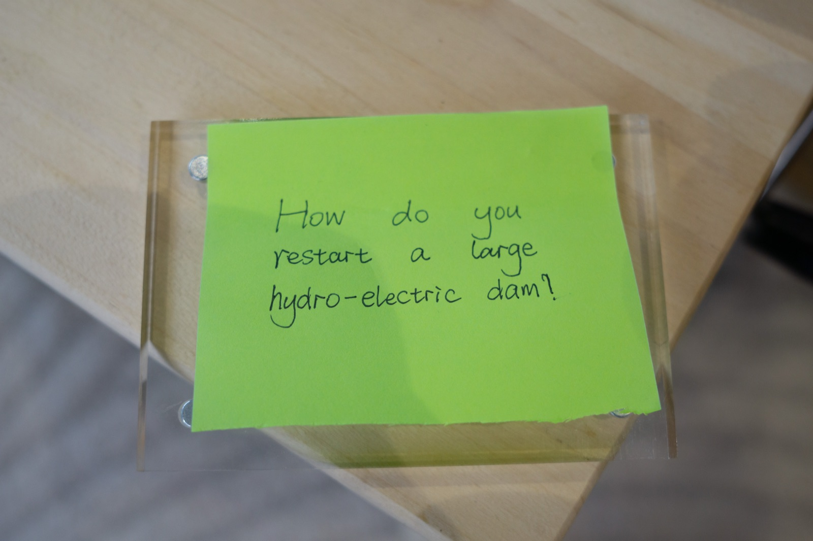

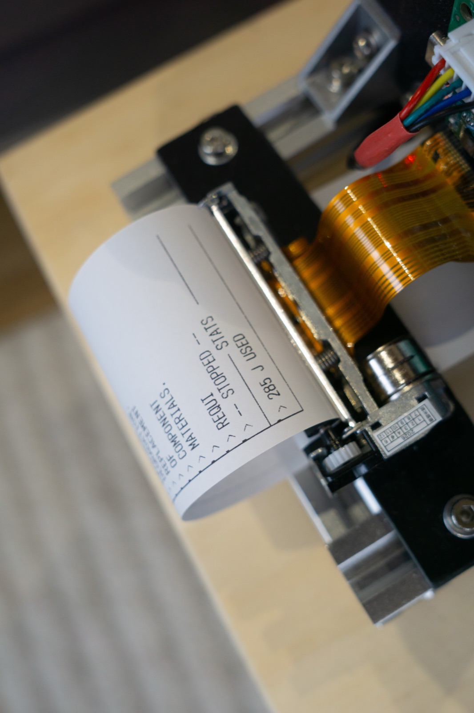

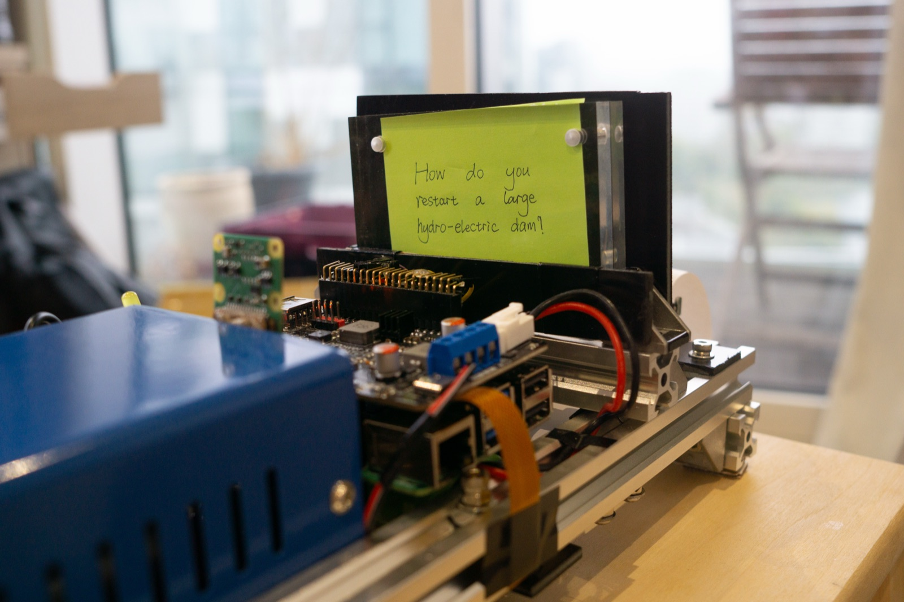

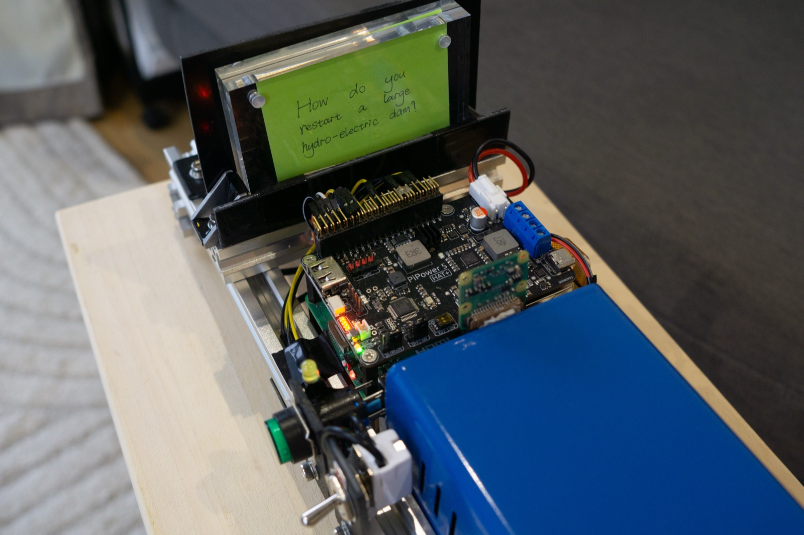

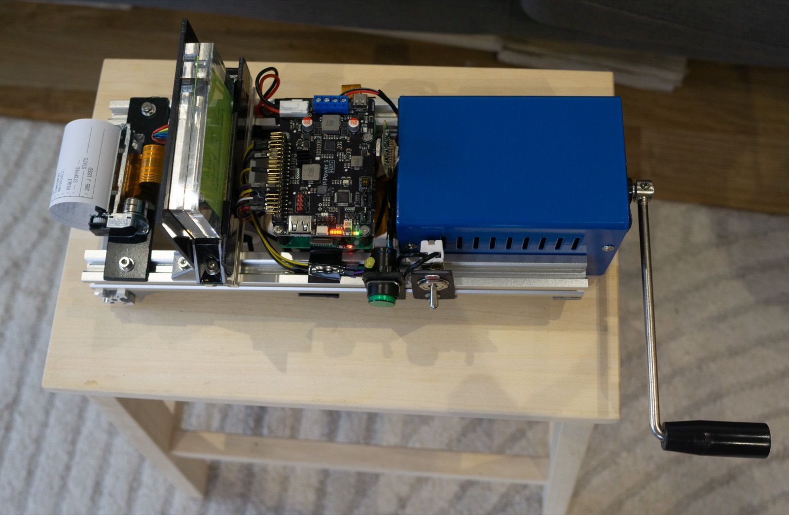

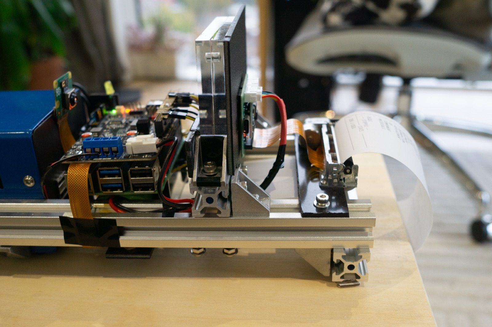

## Parts
- Raspberry Pi 5 (4 GB)
- Raspberry Pi Camera Module 3
- Emergency hand-crank generator
- SunFounder PiPower 5 with a 7.4 V 2S 2000 mAh 18650 pack
- DP-CORE_V1 thermal panel printer
- Green momentary push button and a toggle switch
- 20x20 aluminium V-slot extrusion frame
